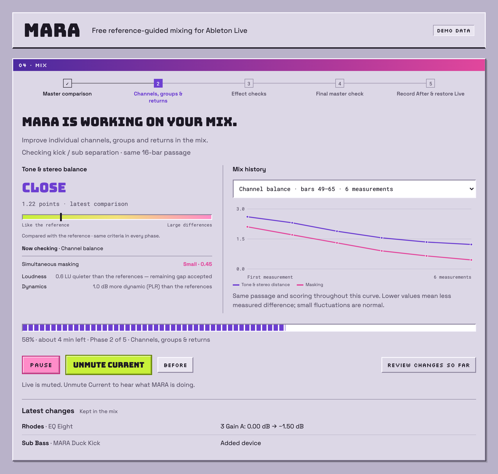
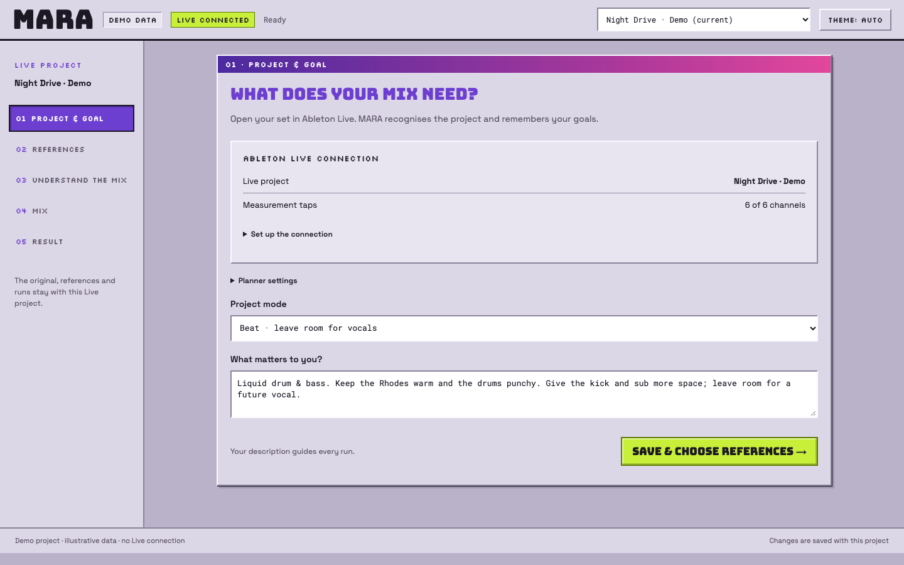
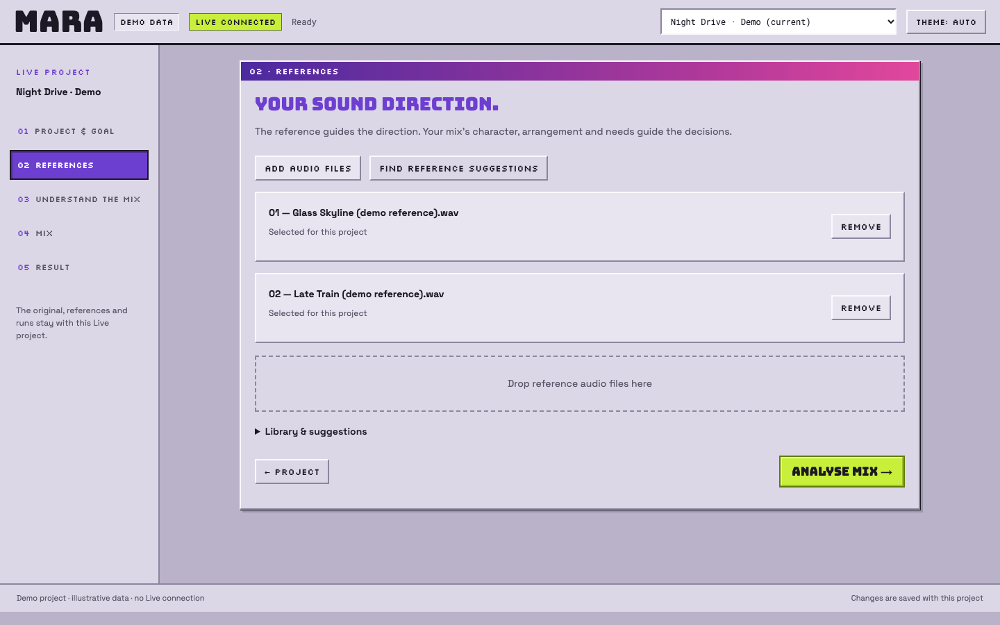
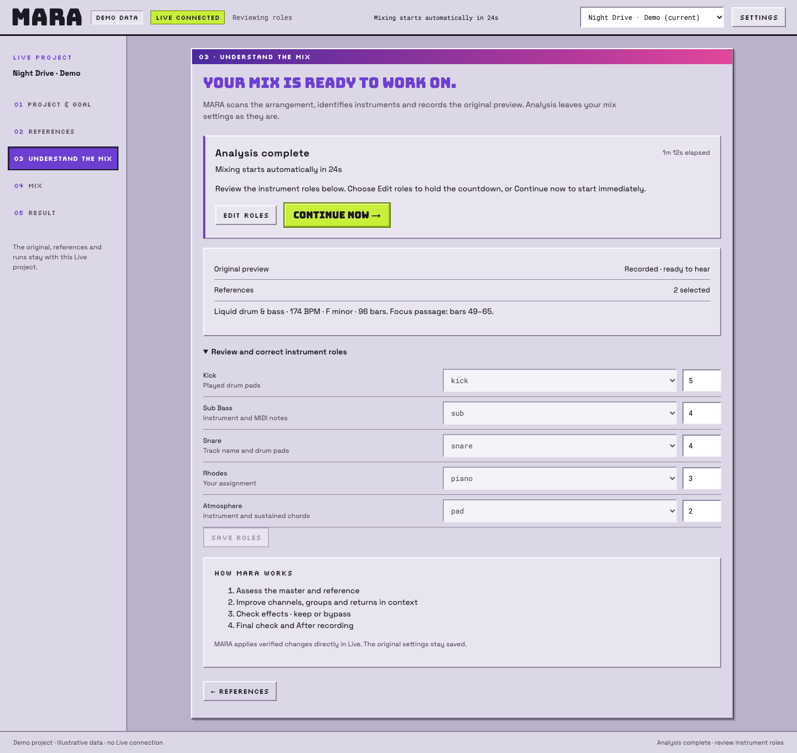
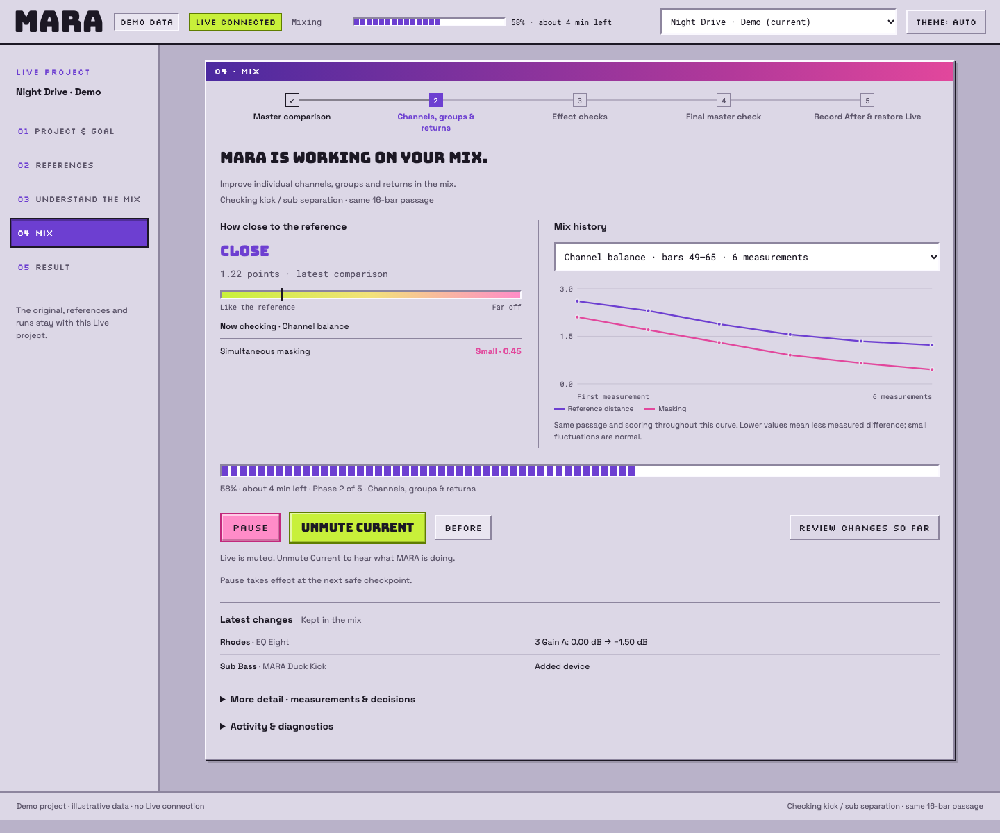
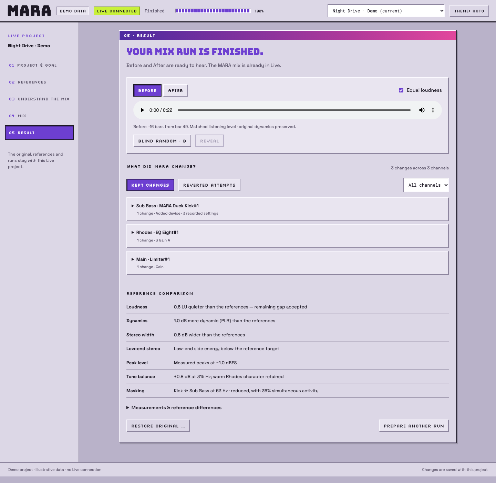
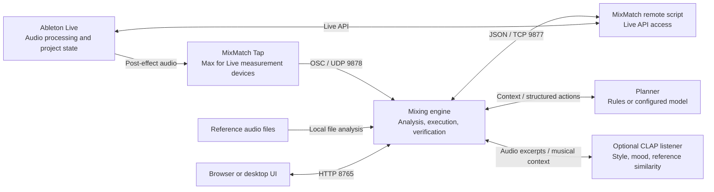

# MARA · Reference-guided mixing for Ableton Live

**MARA is a measurement-driven mixing assistant for Ableton Live.** It combines per-channel audio measurements, reference profiles, and project metadata to plan and execute incremental changes to an open Live set. Each round is evaluated against its stated objective and passage-specific constraints; rejected parameter changes are rolled back.

**MARA directly edits effect parameters across the Live set:** audio and MIDI tracks, groups, returns, and Main. It operates existing devices and can load additional native effects or installed plugins through Live's browser. Control extends to the parameters Live exposes; the current addressing model covers top-level devices and rack macros. Accepted changes remain editable in Live. See [Device and parameter actions](#device-and-parameter-actions) for the integration boundaries.

The processing engine can use built-in rules or be extended with a model-based or custom planner. An optional local **CLAP audio model** analyzes waveform excerpts to estimate musical style and mood and retrieve similar reference tracks. The UI combines these capabilities with progress monitoring, an edit journal, and loudness-matched Before/After recordings.



*Mix view: phase progress, reference-distance and masking histories, monitoring controls, and retained parameter changes. Displayed values are fictional demo data.*

## [Download MARA → GitHub Releases](https://github.com/moritzlauper/mara/releases)

**MARA** names the interface and desktop application; **MixMatch** names the Python package, CLI, and Ableton control surface.

> **Development status:** Version 0.1.0. This document describes the implementation reviewed on November 10, 2026. Automated tests cover the simulator and individual components; they do not replace sound-quality and compatibility checks in real Live sets. Screenshots show the actual interface with explicitly fictional demo data.

[How to use](#how-to-use) · [UI workflow](#ui-workflow) · [Processing capabilities](#processing-capabilities) · [Architecture and algorithms](#architecture-and-algorithms) · [Tool comparison](#comparison-with-existing-tools) · [CLI](#cli-for-advanced-use)

## Technical overview

MARA uses a closed feedback loop. The planner proposes an intervention; local verification code decides whether to retain it based on new measurements.

1. **Measure the signal.** Max for Live taps transmit 31 third-octave RMS bands, mid/side levels, low-frequency side energy, and peaks at approximately 10 Hz over local OSC/UDP.

2. **Read and control the project.** A control-surface remote script exposes tracks, groups, returns, Main, and their devices through a local JSON/TCP connection. Generic parameter actions provide direct control of exposed effect settings alongside dedicated EQ, dynamics, and mixer actions.

3. **Plan an intervention.** The Python engine combines measurements with reference profiles, instrument roles, arrangement activity, and user constraints. The planner is replaceable: use built-in rules, configure a supported model provider, or implement the `plan(context)` interface.

4. **Apply and verify.** The executor applies bounded parameter changes and remeasures the passage. Acceptance checks cover the intended improvement, cumulative drift, headroom, dynamics, and active layers. Rejected parameter changes are rolled back.

5. **Record the result.** Project-specific checkpoints, parameter snapshots, an edit journal, and comparison recordings support resume, review, and restoration.

For musical context, the optional [CLAP listener](#audio-understanding-with-clap) processes actual audio excerpts and compares their learned representations with style descriptions and candidate references. The normal mixing planner receives structured measurements and metadata; CLAP supplies the audio-based analysis used in reference discovery.

Measurement, reference analysis, execution, and verification run locally. The configured planner may use an external model service. See [Architecture and algorithms](#architecture-and-algorithms) for protocols, feature calculations, and acceptance criteria.

## How to use

The **graphical interface is the primary workflow**. It provides connection setup, planner configuration, reference selection, analysis, execution, and result review.

### 1. Open MARA

**Download and install MARA from [GitHub Releases](https://github.com/moritzlauper/mara/releases), then open the app.** This is the recommended installation path. MARA starts the local engine and opens the guided workflow; continue with [the Ableton connection](#2-configure-the-ableton-connection).

<details>
<summary>For developers: run from source</summary>

To run from this repository instead, you need Python 3.10 or newer and Ableton Live with **Max for Live**. From the project directory:

```bash
python3 -m venv .venv
source .venv/bin/activate
python -m pip install -e .
mixmatch ui
```

On Windows, activate the environment in PowerShell with `.venv\Scripts\Activate.ps1`.

Then open **[http://127.0.0.1:8765/workflow](http://127.0.0.1:8765/workflow)**. This is the five-step interface documented below. Currently, `mixmatch ui` initially opens the older overview at `/`; the desktop app opens `/workflow` directly.

</details>

### 2. Configure the Ableton connection

1. Open and save your Live set.
2. In MARA, go to **Project & goal → Set up the connection**.
3. Choose your existing **Ableton User Library** folder and click **Install connection**. MARA copies the remote script and measurement device there, backing up existing installation files as `.previous`.
4. Restart Live. Under **Settings → Link/Tempo/MIDI → Control Surface**, select **MixMatch**, with Input and Output set to **None**.
5. Back in MARA, click **Set taps**. Check that every required channel has a measurement device.

Place **MixMatch Tap** at the end of each track, group, return, and master device chain. The device passes audio through unchanged and measures the post-effect, pre-fader signal. Run **Set taps** again after adding tracks.

On macOS, identifying the saved Live document may also require access to Live's window. If the project cannot be identified reliably, the UI can block a run to keep results associated with the correct project.

### 3. Configure the planner

Built-in rules provide a mode that requires no model account. Configure an external or local model planner to add contextual reasoning over the same measurements and action interface. Developers can also integrate a custom planner through the engine's [planner interface](#planner-extensibility).

Open **Planner settings** in **Project & goal**. Select a provider and model, enter an API key if needed, and click **Save planner**. **Load models** retrieves available model IDs; you can also enter an ID manually. Changes apply on the next start or resume.

| Planner | Execution path |
| --- | --- |
| **Automatic** | Uses Claude Code when installed and on PATH. With an Anthropic API key configured, switches to the selected API model for the rest of the run when Claude Code reports a usage or rate limit; other errors do not trigger this switch. Without Claude Code, uses the configured API directly, or built-in rules if no API key is configured. |
| **Claude Code** | Uses your local Claude Code login and the selected model for the mixing phases. |
| **Anthropic** | Plans through the Anthropic API with your key. |
| **Google Gemini** | Uses the configured Gemini endpoint with your key and selected model. |
| **OpenAI-compatible API** | Supports suitable hosted or local Chat Completions endpoints with JSON output. Protocol compatibility alone does not guarantee useful mixing plans. |
| **Built-in rules** | Requires no AI account for mixing, with a narrower scope: broad master balance, limiter adjustment, mono bass, and measured masking. |

In **Automatic** mode, the API cost estimate assumes the **entire mix is planned through the Anthropic API**. These charges are separate from your Claude Code plan and apply only to API calls actually made. If Claude Code handles the entire run, no mixing-planner API charges apply; if it reaches a limit partway through, only the remaining calls use the API.

API keys are stored through the operating system's credential store. The UI displays a rough cost estimate for models with configured pricing; actual API usage depends on channel count, rounds, model, and retries. Automatic reference discovery has additional requirements; see [Finding references](#finding-references).

Open **Settings** with **⌘,** on macOS or **Ctrl+,** on Windows to see the actual data folder and set a reference library folder. The default desktop data folder on macOS is `~/Library/Application Support/MARA`; an existing service can use a different workspace. **Connection & planner** opens the Live connection and planner settings. A packaged update starts its bundled engine when an older service is idle; an active run is kept on its current engine until you reopen the app after it stops.

## UI workflow

The screenshots use **Night Drive**, a fictional instrumental drum-and-bass project at 174 BPM. The fixture includes drums, sub bass, Rhodes, atmospheric layers, and an intended later vocal recording. Project metadata, references, measurements, and edits are synthetic. The **DEMO DATA** badge identifies the documentation fixture.

### 01 · Project & goal: define the processing objective

Check the Live connection and tap count. Under **Project mode**, choose automatic detection, **Beat · leave room for vocals**, **Instrumental · no space reserved for vocals**, or **Song with vocals**. Choose Instrumental for a finished beat without planned vocals: MARA uses the full reference balance without reserving a vocal pocket. Reference vocals still do not need to be imitated by boosting instruments.

Use **What matters to you?** to specify the desired changes and properties to preserve. For example: “Reduce kick/sub overlap; preserve the Rhodes tonal balance and drum transients; reserve space for later vocals.” This description becomes part of the planner context. Click **Save & choose references →**.



### 02 · References: configure the target material

Use **Add audio files** or drag and drop reference files. The UI accepts WAV, AIFF, FLAC, MP3, M4A, and AAC, converting imports when required. Complete tracks are preferred because short previews may omit representative sections and contain fades.

Use **Browse & listen** to search and audition references, including during an active mix. **Pause to change references** stops at a safe checkpoint before changing the selected target. You can return to any workflow step without leaving the run. Expand **Library & suggestions** to see additional candidates from the shared library or earlier discovery runs. **Find reference suggestions** starts the optional discovery workflow. MARA also recognizes audio clips on Live tracks containing a separate `REF` or `Reference` word in their name, such as `REF Glass Skyline`. These tracks can remain muted because MARA reads the clip files directly.

Select references with relevant instrumentation and production characteristics. Multiple references form a weighted target profile with frequency-dependent tolerances. Adding a file does not start processing. Click **Analyse & mix →** to start one continuous run.



### 03 · Understand the mix: validate analysis and roles

MARA plays through the selected song range, examines channel activity, finds the loudest passage, and records the original preview. Preparation does not apply mixing corrections, although Live's transport and recording state are temporarily controlled for analysis and capture.

**Review and correct instrument roles** opens automatically after analysis. Validate each channel's inferred role and priority. Role assignments distinguish functions that spectral measurements alone cannot resolve, such as a bass, lead, or pad using the same synthesizer. Priorities range from 1 to 5 and inform foreground/background relationships. Choose **Edit roles** to hold the countdown. Saved corrections apply to the upcoming mixing pass.

Once analysis and the original recording are ready, mixing starts automatically after **30 seconds**. **Continue now →** skips the wait. Editing roles holds the review window until you continue. Reference discovery remains a separate preparation step so you can choose suitable references before processing.



### 04 · Mix: monitor execution and retained changes

A complete run works through five phases:

1. **Master comparison:** assess the starting mix and references.
2. **Channels, groups & returns:** work on channels by priority, in suitable passages.
3. **Effect checks:** test suitable existing effects and bypass them when justified.
4. **Final master check:** revisit the strongest unresolved source, then verify the overall balance and master after channel adjustments.
5. **Record After & restore Live:** record the result and restore the temporary recording state.

The dashboard displays reference distance and potential masking separately. History series group measurements by passage and scoring method so that different evaluation contexts remain distinguishable. Lower values indicate reduced measured cost within that context; the values do not constitute a perceptual quality score.

**Kept changes** and **Reverted attempts** are available directly in the Mix view, with channel filters and parameter details. The compact **Latest changes** section below them is collapsed by default. **Review changes so far** opens the result view.

Runs started in the UI mute Live's output by default. On bridges exposing output routing, MARA also disconnects the Main hardware route while muted; measurements continue upstream. Preview recording preserves an existing mute, and failed tail checks never automatically reopen the output. **Unmute Current** lets you hear the working mix, including changes still being tested. **Before** plays the saved original. The original recording and running Live signal can be approximately loudness matched when the current measured passage matches the preview passage.

MARA disables Live's metronome and turns Cue volume down before playback and recording, so the separate cue output stays silent too. These stay off afterwards; raise Cue volume in Live if you want to use its preview or cue listening again.

**Pause** takes effect at the next safe checkpoint, which may be after a model response or measurement finishes. **Resume** continues from saved progress. Expand **More detail · measurements & decisions** for measurements and decisions, or **Activity & diagnostics** for the log. An updated project goal can guide the next planning step.



### 05 · Result: evaluate and inspect the processed set

Retained processing is already applied to the Live set. **Before** and **After** play recorded excerpts of the same passage, normally 16 bars.

- Keep **Equal loudness** enabled for a fairer comparison of tone, balance, and dynamics. The louder recording is attenuated to the quieter one; original audio files and mix settings are preserved.
- **Blind random · B** randomly selects either version. **Reveal** shows which one is playing. Repeats are possible; this is not a statistical ABX test.
- **Kept changes** lists the saved changes. Expand an entry to inspect parameters, before/after values, and reasons. **Reverted attempts** shows rejected experiments.
- **Reference comparison** explains remaining differences. Some distance may remain deliberately, for example to retain punch or warmth.
- **Restore original …** prepares a restore and asks for confirmation. MARA checks the open project and intervening parameter changes before restoring settings.
- If only the result recording is missing, **Repair preview** creates the missing preview without repeating the mixing pass.

Save the result you want in Ableton Live as usual. MARA's saved snapshots contain parameter states; they do not replace a complete backup of the `.als` file.



## Production use cases

| Requirement | Mechanism | Workflow benefit |
| --- | --- | --- |
| Kick/bass separation | Time-aligned overlap analysis, foreground/background priorities, EQ, and sidechain ducking. | Coordinates source-level interventions and measures their effect in context. |
| Reference alignment | Tonal, loudness, dynamics, and width comparison with per-band tolerances. | Relates master differences to candidate source tracks and available controls. |
| Instrumental preparation for vocals | Beat-mode target adjustment across 200 Hz–5 kHz. | Allows a defined spectral range for later vocals when comparing against complete songs. |
| Arrangement-dependent processing | Activity scan and channel-specific measurement passages. | Evaluates channels where they are active and limits reference matching outside the main passage. |
| Result evaluation | Matched-loudness recordings, blind playback, and a parameter journal. | Supports listening comparisons and inspection of retained and rejected interventions. |

MARA automates repeated measurement and adjustment work. Time savings and perceptual improvements have not been established through controlled user or listening studies.

## Processing capabilities

### Channel-role inference

Role inference combines track names, instrument and sample metadata, rack contents, played MIDI notes, and coarse audio features. The role taxonomy covers drums, bass types, lead and backing vocals, vocal chops, synths, pads, keys, guitars, strings, effects, and buses.

For Drum Racks, MARA examines the pads actually played. A rack using only one kick pad can be recognized as a kick; a mixed kit can become a drums bus. A Drum Buss effect does not by itself define the instrument's role.

Roles are stored in each project's `roles.json`. Besides the UI's role and priority controls, this file can hold notes such as “This is the hook; keep it upfront.” Corrected roles can be revisited during a resumed run without repeating every unchanged channel. Detection is heuristic and remains editable.

### Arrangement-aware measurement windows

A complete default run scans the range defined by locators or the current loop, then normally selects its loudest 16 bars. Without suitable locators, make the loop cover the intended song range. A short loop does not produce a full-song scan.

Tracks that are not sufficiently active in the main passage get their own measurement window. Muted tracks and tracks inside muted groups are skipped in the channel pass. Outside the main passage, MARA focuses on conflicts, peaks, and stereo bass instead of matching a sparse intro to a full reference spectrum. During channel balancing, master loudness and reference PLR are excluded from the optimization score.

The CLI can also work through locator sections or run a shorter pass without visiting every channel.

### Reference-profile construction

Reference files are analyzed locally through a filter bank corresponding to the live tap's band layout. Audio is divided into 100 ms frames and ranked in 3-second blocks. The profile retains the loudest 30% of blocks, subject to a 3 LU distance from the loudest block. This reduces the influence of intros, fades, and low-energy breakdowns. File profiles are cached.

Multiple references form a weighted mean profile. Files shorter than 60 seconds receive half weight; when longer files are available, loudness, peak, and PLR targets are derived from those longer files. The tonal tolerance in each band is `0.5 dB + 0.5 × standard deviation` of the reference shapes in that band. Reference disagreement therefore widens the acceptable range.

The `mix-first-v2` diagnosis summarizes the spectrum in six regions: sub, bass, low mids, mids, presence, and air. For each region, it reports the reference deviation and the three strongest measured source tracks, excluding groups and returns. Source levels are relative observations, not additive contributions: routing and correlation prevent that interpretation. Roles, arrangement activity, and user constraints provide context for deciding whether a reference deviation warrants processing.

### Beat-mode reference adaptation

In **Beat mode**, MARA compares the instrumental against complete reference songs. Between approximately **200 Hz and 5 kHz**, the beat may sit about **4 dB below** the references, in addition to ordinary reference tolerance. Spectral level alignment uses regions outside that vocal range. Loudness and dynamics still refer to the complete songs.

Automatic mode accounts for muted vocal tracks and muted parent groups. If the scan finds all vocal tracks silent throughout the scanned range, it can switch to Beat mode. Explicit Beat or Song selections take precedence.

Demucs-based vocal separation is implemented as an optional facility. The current Beat-mode target uses complete reference files and does not require separated stems.

### Device and parameter actions

**Direct effect control is available across every track category**, including individual audio and MIDI tracks, group buses, returns, and Main. The generic `param` action addresses a track, device index, exact parameter name, and numeric target in Live's displayed units. It can modify existing native devices and third-party plugin parameters exposed by Live. `load_device` adds a suitable native effect or installed plugin for subsequent configuration.

The action interface combines generic parameter access with device-specific behavior, such as EQ-band selection, limiter setup, or sidechain routing:

| Area | Implemented actions |
| --- | --- |
| **Balance** | Adjust channel volume and pan, including groups and returns. |
| **EQ** | Add or use EQ Eight; apply bell, low/high shelf, low cut, and notch filters; reuse suitable existing bands. |
| **Stereo** | Change Utility width and enable Bass Mono. |
| **Dynamics** | Load suitable devices and adjust parameters exposed by Live, such as threshold, ratio, attack, and release. |
| **Space** | Change sends to existing returns and adjust return level, EQ, and width. |
| **Ducking** | Create a dedicated native Compressor on the background signal, triggered by a measured foreground source. |
| **Master** | Set limiter gain and ceiling; use a recognized Classic Clipper plugin before the limiter. |
| **Existing effects** | Address exposed parameters through `param`, including effect settings and device enable/bypass state. |
| **Plugins** | Discover installed plugins through Live's browser and use exposed parameters. Pro-L 2 is preferred for the master limiter when available. |

The current parameter-addressing path enumerates the top-level device chain of each track. Rack macros are accessible through the rack's exposed parameters; devices inside nested rack chains are inspected for role inference but are not recursively addressable for parameter writes. Automated parameters and parameters locked after a detected manual edit are excluded from normal execution. MARA's managed duckers retain their dedicated routing and attenuation restrictions.

Plugin support depends on the parameters exposed through Live and their numeric/display mapping. Hidden controls in a plugin's own window are outside this interface. A newly loaded plugin that exposes no usable parameters is removed after setup fails. The dedicated EQ action uses EQ Eight; other EQs can use the generic parameter path when their controls are accessible.

Action availability and verification coverage are separate concerns. The available measurements provide limited evidence for compression character, spatial depth, and other perceptual properties.

### Temporal masking analysis and sidechain ducking

Masking detection checks **simultaneously active** measurement frames at roughly 100 ms intervals. It accounts for track and group faders, excludes silence and very quiet tails, and preferentially protects the higher-priority source. A group is not counted as masking its own members; certain background and bus roles are excluded from pair analysis.

Sustained overlap can lead to small static EQ cuts. Repeated intermittent collisions can lead to **broadband sidechain ducking**: a Post FX trigger, RMS detection, 2 ms attack, 50–250 ms release, and attenuation bounded to at most 3 dB through dry/wet mixing. This is not frequency-selective dynamic EQ.

The ducking action does not reroute existing sidechain compressors or stack its own duckers. Failed setup or a rejected round removes the new ducker. Missing or poorly aligned observations cannot count as verified improvement.

### Audio understanding with CLAP

MARA includes a local audio-analysis component, [`Listener`](mixmatch/style.py), backed by **CLAP**. It consumes waveform excerpts and encodes audio and text descriptions into a shared embedding space. This provides musical-content information beyond the live level and spectrum measurements.

The analysis converts audio to 48 kHz mono and selects up to three high-energy, non-overlapping 10-second excerpts. Their normalized embeddings are averaged and compared with text or audio embeddings using cosine similarity. The resulting features support:

- **Style estimation:** rank predefined genre and production-style descriptions by similarity to the audio.
- **Mood estimation:** rank descriptors such as dark, euphoric, aggressive, or dreamy.
- **Reference retrieval:** compare the project excerpt with audio files from the reference library or music collection and rank candidates by similarity.

The preferred backend uses LAION's music-trained CLAP checkpoint, with `laion/clap-htsat-unfused` as a fallback. Audio embeddings are computed locally and cached. Separate signal-analysis routines estimate tempo, key, and chords; these estimates are not generated by CLAP itself.

CLAP is used in optional reference discovery and suggestions. Its similarity scores describe content relationships; they do not establish mix quality or validate individual EQ and dynamics decisions. The normal mixing planner receives structured evidence, while local measurements verify processing changes. See [Finding references](#finding-references) for setup and usage.

### Harmonic context and resonance analysis

MARA can estimate key and chords from arrangement MIDI. Audio-file analysis also includes chroma-based harmony estimates, tempo, style, and mood. These provide context and support reference discovery; they do not correct notes.

An additional high-resolution recording analysis searches for narrow resonant peaks that the 31 live measurement bands can miss. Peaks matching notes of the estimated key are excluded where possible. Master fine analysis is enabled by default. Similar single-channel recording support exists in the code but is disabled by default because that routing has previously caused stability problems in Live.

### Existing-device audit

Effect auditing is optional (`--audit`, or **Audit existing effects** in the classic interface) because testing every device on and off can dominate the run time on large sets. Neutral EQ Eight and Utility settings can be bypassed. Other suitable effects are measured on and off. A potentially harmful effect should remain bypassed only when repeated measurements show a benefit for peaks, stereo bass, or masking while the protection checks still pass.

Automated effects, meters, and recognized time-varying or creative effects such as reverb, delay, chorus, and certain modulators are excluded. The master limiter/clipper chain is handled separately. The audit bypasses existing devices so their previous state remains recoverable. Use `--audit` in the CLI when you want this additional phase.

### Finding references

Optional discovery begins with an internal recording of a master passage. The [CLAP listener](#audio-understanding-with-clap) analyzes its musical content and ranks candidate audio by similarity. Candidates can come from `references/`, your music library, and optionally Jamendo. Model embeddings and file analyses are cached.

Automatic selection also uses a loudness threshold as a rough filter for finished masters. This is not a quality test and can exclude deliberately dynamic releases. Your description takes precedence over the model's style guess in the text-based interpretation.

MARA can also suggest released tracks with Bandcamp, Beatport, or Spotify search links and look up available Apple previews. With `JAMENDO_CLIENT_ID`, it can include permitted Jamendo downloads. Import helpers handle downloaded audio and ZIP files; a download watcher can recognize files matching suggestions. MARA does not automatically buy commercial music or extract it from streaming services.

Discovery is optional and pauses for reference selection before mixing begins. Its text suggestions currently use a separate Claude/Anthropic path; choosing Gemini or a compatible API for the mixing planner is not yet consistently carried over to this feature.

To install optional local style-model dependencies:

```bash
python -m pip install -e ".[style]"
```

The preferred LAION music checkpoint is set up on first use through a separate `uv` environment and needs additional downloads and storage. A more general CLAP model is the fallback. Selecting reference files manually avoids this extra dependency.

### Project identity and checkpointing

Each project has its own description, roles, selected references, logs, checkpoints, snapshots, and audio previews. The saved Live file path is the preferred identity, helping distinguish **Save As** copies and projects with similar channel layouts.

A shared reference library can serve multiple projects. The UI lets you inspect saved projects and return to the connected Live project. Interrupted runs can continue from checkpoints while retaining the original Before recording. Progress and remaining time are estimated from the workload and the run so far.

## Architecture and algorithms

### Runtime components and data flow



The measurement, control, and UI endpoints bind to `127.0.0.1` by default. The remote script exchanges newline-delimited JSON requests and responses over TCP. It polls requests on Live's main thread, where Live API operations must execute. OSC measurements arrive independently over UDP and are buffered by the Python `TapHub`.

The UI provides configuration, monitoring, and playback. The Python engine schedules analysis windows, invokes the planner, applies actions through the remote script, and persists run state. Native Live devices and plugins perform the audio processing.

### Signal acquisition and feature extraction

Each tap emits a channel identifier and 36 measurement values per frame: mid RMS, side RMS, low-frequency side RMS, left/right peaks, and 31 band RMS values. The receiver timestamps frames on arrival and retains up to 3,000 frames per tap, approximately five minutes at 10 Hz. Measurements are taken after the device chain and before the channel fader; relevant channel comparisons apply the channel and parent-group fader gains.

For each measurement window, silent frames are excluded from level statistics. The overlapping filter-bank powers are normalized to the measured mid-signal power before averaging. This avoids treating the sum of overlapping bands as the signal's absolute power. Tonal shape is expressed relative to estimated loudness; reference differences are smoothed over three adjacent bands.

| Feature | Calculation and interpretation |
| --- | --- |
| **Tonal shape** | Calibrated band level minus estimated loudness. Reference scoring uses bands from 30 Hz to 16 kHz, after smoothing and target tolerances. |
| **Loudness** | K-weighted band-power estimate with an additional side-power term. It is an approximate live measurement rather than a complete integrated LUFS measurement. |
| **Dynamics** | Peak-to-loudness ratio: `PLR = peak dBFS − estimated loudness`. This is a proxy for dynamics, with limited sensitivity to transient shape. |
| **Stereo width** | `20 × log10(side RMS / mid RMS)`. Low-frequency side energy below 150 Hz is tracked separately relative to mid. |
| **Peak level** | Maximum observed left/right peak in the active measurement window. This does not establish true-peak compliance. |
| **Activity** | Fraction of frames above the silence threshold, used to identify active passages and detect disappearing layers. |
| **Potential masking** | Time-aligned band overlap between eligible channel pairs, after gain compensation and activity gating. It indicates a possible conflict rather than perceptual audibility. |

Reference-file analysis produces the same `Frame` and `Stats` representations as the live path. This gives reference comparison and live evaluation a common feature layout, while retaining the measurement limitations described above.

### Planner context and action contract

The planner receives channel roles and priorities, device and parameter summaries, reference deviations, measured overlap, harmonic context, user constraints, and recent round history. The diagnosis associates spectral regions with candidate source tracks. Channel passes restrict execution to the current channel, with an exception for sends feeding a return under review.

The structured model response contains an `assessment`, a `mix_intent`, an `actions` array, and a `done` flag. `mix_intent` identifies one measurable priority, supporting evidence, properties to preserve, and the relevance of the reference. Supported priorities include masking, tonal balance, dynamics, width, loudness, low-frequency side energy, and clipping.

The following abbreviated response illustrates a proposed EQ intervention; unused nullable action fields are omitted. It is an example of the contract, not an observed mix result.

```json
{
  "assessment": "Rhodes and snare show simultaneous low-mid overlap.",
  "mix_intent": {
    "priority": "masking",
    "evidence": "Aligned measurement frames indicate overlap near 315 Hz.",
    "preserve": "Rhodes tonal character and snare foreground priority.",
    "reference_relevance": "The intervention addresses channel overlap."
  },
  "actions": [{
    "type": "eq",
    "track": "t3",
    "shape": "bell",
    "freq_hz": 315,
    "gain_db": -1.5,
    "q": 1.0,
    "reason": "Reduce the background source in the measured overlap region."
  }],
  "done": false
}
```

The executor resolves the action to Live devices and parameters, records previous parameter values, and applies device-specific limits. Ducking additionally requires an observed intermittent collision and supported sidechain routing; its trigger level comes from measurements. An action's reason is recorded separately from its subsequent verification result.

### Planner extensibility

The [`Agent`](mixmatch/agent.py) receives its planner as a constructor dependency and invokes `planner.plan(context)`. A custom Python planner can implement this method and return the assessment, intent, actions, and completion flag described above. The engine retains responsibility for measurement, action execution, acceptance checks, journaling, and rollback.

Existing adapters in [planner.py](mixmatch/planner.py) implement built-in rules, Claude Code, the Anthropic API, and compatible Chat Completions endpoints, including the configured Gemini path. A compatible local model server can be selected through the UI's endpoint settings. A new Python adapter can be injected directly when constructing the engine; exposing it as an additional UI provider requires integration with the planner factory and settings.

### Scoring and acceptance

The full measurement objective combines tonal excess, loudness difference, peak penalty, excess low-frequency side energy, width difference, PLR difference, and potential masking. In [analysis.py](mixmatch/analysis.py), the full score is:

```text
J = T + max(0, |ΔL| − 0.5) + 4 × max(0, P + 1)
      + 0.5 × max(0, ΔS_low) + 0.2 × |ΔW| + 0.3 × |ΔPLR| + M
```

`T` is the RMS tonal deviation remaining outside per-band tolerance; `ΔL` is the loudness difference in LU; `P` is the measured peak in dBFS; `ΔS_low`, `ΔW`, and `ΔPLR` are reference differences in dB; and `M` is the weighted masking penalty. The coefficients define engineering heuristics. The resulting score has no calibrated perceptual unit.

The evaluation context changes the active terms. Channel balancing excludes master loudness and reference PLR. Local passes outside the main reference passage evaluate masking, peaks, and low-frequency side energy. When the allowed limiter/clipper gain is exhausted, a remaining loudness deficit can be excluded from further optimization.

Acceptance is implemented separately in [mix_quality.py](mixmatch/mix_quality.py). The current `mix-first-v2` policy checks the intended benefit and cumulative constraints:

1. **Validate observations.** Require finite measurements and a valid master measurement. Previously observed masking pairs require simultaneous data coverage of at least 60%, or 80% of their previous coverage, whichever is higher.
2. **Verify the stated priority.** The selected metric must improve by more than the configured minimum gain, default `0.05` score units. When repeated-window spread is available, the improvement must also exceed that spread.
3. **Check reference tradeoffs.** A tonal, width, dynamics, or loudness intervention must also reduce the combined reference cost. A masking or headroom intervention can tolerate bounded reference regressions.
4. **Enforce passage constraints.** Compare headroom, low-frequency stereo energy, dynamics, spectral drift, and active-layer levels against the previous measurement and the stored passage baseline.
5. **Persist or restore.** Accepted changes become the next measured state. Rejected rounds restore recorded parameter values and retain their rejection reason in the journal.

Baselines are keyed by passage, scoring mode, project mode, and reference context, and persisted across channel passes and resumes. Accepted rounds do not reset cumulative allowances. This prevents a sequence of individually small compromises from continually expanding the permitted drift. Rule-based or custom plans without structured intent use aggregate improvement with the same protection checks.

### Execution limits and rollback scope

| Dedicated action | Maximum step per action |
| --- | --- |
| Channel volume | ±2 dB |
| EQ gain | ±3 dB |
| Limiter gain | ±2 dB |
| Clipper gain | ±1.5 dB |
| Send level | ±3 dB |
| Pan | 15 display units |
| Stereo width | 25 percentage points |

These limits apply per action; they are not a combined per-round budget. The dedicated limiter path also caps gain at +5 dB and sets the ceiling to −1 dB where available. The clipper path caps gain at +4 dB. A master-EQ response check limits additional combined cuts within the controlled EQ Eight to approximately 3 dB. The generic `param` action does not apply these device-specific step and gain limits.

The executor rejects automated parameters. It detects manual changes to parameters it has already set and is tracking, then locks those parameters for the remainder of the run. This mechanism does not cover every control in the set.

Rejected rounds restore parameter changes in reverse order. Newly created dedicated duckers are removed explicitly; ordinary inserted devices can remain present and be bypassed for the original comparison. Snapshots represent parameter state, not a complete plugin-state or arrangement backup.

### Comparison recordings and monitoring

MARA records Before/After excerpts internally through a temporary Resampling track. The temporary track is removed after capture; audio files may remain in Live's `Samples/Recorded` folder. Both excerpts use the same passage, normally 16 bars.

Recorded-file loudness matching uses `pyloudnorm` integrated BS.1770 measurements and attenuates the louder recording to the quieter recording's level. Monitoring against the running Live signal uses the approximate live measurements and requires a matching passage. These are separate comparison paths with different measurement precision.

## Comparison with existing tools

MARA operates as a **project-level analysis and control layer for Ableton Live**. Its distinguishing scope combines access to original tracks and devices, role and arrangement context, structured interventions, and local acceptance checks. AI suggestions, unmasking, reference discovery, and loudness matching are established capabilities in other products.

This comparison uses manufacturer documentation checked on **November 10, 2026**, alongside MARA's implementation. It is a feature comparison, not a sound-quality benchmark or evidence of an exclusive market claim.

| Tool | Existing capabilities | MARA's emphasis in comparison |
| --- | --- | --- |
| **FabFilter Pro-Q 4** | Dynamic and spectral EQ, EQ Match, mid/side processing, and an instance overview for supported FabFilter plugins. [Manufacturer](https://www.fabfilter.com/products/pro-q-4-equalizer-plug-in) | MARA coordinates several kinds of mixing actions and their verification inside Live. Pro-Q is a specialized processor with substantially deeper EQ controls. |
| **iZotope Neutron 5** | Mix Assistant, signal-chain suggestions, Unmask, Visual Mixer, and inter-plugin communication with Relay. [Manufacturer](https://www.izotope.com/products/neutron?tab=features) | MARA uses Live tracks, groups, returns, MIDI/rack information, and accessible devices as its working context. Automatic balancing and contextual processing alone are not unique to MARA. |
| **sonible smart:EQ 4** | Automatic spectral balance, reference profiles, and unmasking for groups of up to ten tracks, with foreground/middle/background priorities. [Manufacturer](https://www.sonible.com/products/smarteq4/) | MARA applies roles and priorities across level, sends, dynamics, master processing, and a project workflow. smart:EQ provides specialized adaptive spectral processing. |
| **iZotope Ozone 12** | Master Assistant with references and loudness targets, plus tools such as Stem EQ for components within a stereo bounce. [Manufacturer](https://www.izotope.com/products/ozone-advanced) | MARA can address causes in the original Live tracks and their devices. Ozone has a substantially broader dedicated mastering toolset. |
| **Mastering The Mix REFERENCE 3** | Loudness matching, multiple references, automatic library matching, loudest-section loops, and written mixing guidance. [Manual](https://www.masteringthemix.com/pages/reference-manual) | MARA adds parameter changes in the set, measurement checks, and an edit journal. Reference selection and fair A/B comparison alone do not distinguish it. |
| **iZotope Assistant, Labs beta** | LLM-based conversation, analysis, and control of compatible iZotope plugins; documented as a limited beta in Tonal Balance Control 3 and Ozone 12. [Manufacturer FAQ](https://support.izotope.com/hc/en-us/articles/47669691480077-iZotope-Labs-and-iZotope-Assistant-FAQ) | Natural-language control and changes across plugins also exist in the market. MARA focuses on its specific Ableton workflow, selectable planners, and an inspectable feedback loop between actions and measurements. |

MARA depends on the processing capabilities and parameter interfaces of the devices it controls. Its verification covers the implemented measurements; final evaluation remains a listening decision.

## Current limitations

- **Ableton-specific:** The remote script and Max for Live are required. Equivalent integrations for Logic, FL Studio, Reaper, or Pro Tools are not implemented here.
- **Real-time work:** Scanning, repeated loops, effect checks, and previews require playback time, with model response time on top. There is no reliable fixed duration for every project.
- **Perceptual coverage:** Spatial depth, groove, timbre, and transient behavior are only partly represented by the feature set. Lower measured cost does not establish higher perceived quality.
- **Mixing scope:** The intended mixing actions do not edit melodies, lyrics, or song structure, or write new automation moves.
- **Timing assumptions:** Many bar calculations assume four quarter-note beats per bar. Unusual meters and complex tempo changes are not established as fully supported.
- **Reference choice:** Unsuitable references, short clips, and incorrect roles can skew decisions. Style and track suggestions need review.
- **Project structure:** Tap matching uses channel names among other information, so distinct names help. Major changes during a run or after a snapshot can complicate matching and restoration.
- **Platforms:** Desktop code and packaging workflows exist for macOS and Windows. This does not establish tested installers on every platform; the additional window-based document-path lookup is macOS-specific.
- **Validation:** Simulator and component tests establish behavior within their test conditions. Broader integration and listening tests are still needed across Live versions, plugins, and musical material.

## Local data and external services

Measurements, reference analysis, state, and audio previews are processed or stored locally. A cloud planner receives structured information such as channel names, roles, parameters, measurements, notes, and recent history. The normal mixing planner does not upload project audio as an audio input.

Optional reference discovery can download model files and make requests to Claude/Anthropic, Apple, or Jamendo. Built-in rule planning itself requires no AI service. Choose local reference files and skip discovery and suggestions when you want to avoid those additional services.

```text
references/                    Shared reference library
songs/<project>/
  mixmatch.json                Description and project mode
  roles.json                   Roles, priorities, and notes
  references/                  References selected for this project
  runs/                        Logs, checkpoints, snapshots, journal, previews
```

The desktop app defaults to `~/Library/Application Support/MARA` on macOS and `%LOCALAPPDATA%\MARA` on Windows. `MARA_WORKSPACE` overrides the location. Starting `mixmatch ui` from a repository uses that working directory for projects. On first UI startup, legacy `runs/`, `roles.json`, and `mixmatch.json` can migrate into the project structure; the shared reference library stays in place.

## CLI for advanced use

The UI covers the normal workflow. The CLI remains useful for specific run variants and diagnostics:

```bash
mixmatch ui                                      # Start the UI; open /workflow
mixmatch check                                   # Check Live, taps, and roles
mixmatch taps                                    # Insert measurement devices
mixmatch taps --replace                          # Refresh taps after a device update
mixmatch taps --remove                           # Remove taps from the set
mixmatch refs ~/refs/song1.wav ~/refs/song2.mp3   # Prepare reference analysis
mixmatch run --ref ~/refs/ --no-suggest          # Complete run with your references
mixmatch run --ref ~/refs/ --quick --no-suggest  # Shorter run without channel passes
mixmatch run --ref ~/refs/ --audit                # Also A/B-test eligible existing effects (slower)
mixmatch run --continue --ref ~/refs/ --no-suggest
mixmatch run --ref ~/refs/ --mode beat --assist --no-suggest
mixmatch run --ref ~/refs/ --focus sections --minutes 15 --no-suggest
mixmatch ab before                              # Recall saved parameters in Live
mixmatch ab after
mixmatch repair-preview                          # Generate missing comparison audio
mixmatch demo                                    # Run the mixing loop in the simulator
```

`--assist` asks in the terminal before applying each round. `--minutes` sets a time budget; without it, a complete run aims to finish all phases. `--silent` mutes Main while working; the UI enables this by default. When restoring output, MARA waits for effect tails to decay. If it cannot confirm sufficient silence, output remains muted.

For optional reference discovery:

```bash
mixmatch suggest-refs my-beat.wav --note "Atmospheric drum and bass"
mixmatch suggest-refs my-beat.wav --library ~/Music
mixmatch run --auto-ref --review-references
```

A run without explicit references enables discovery by default. Use `--no-auto-ref --no-suggest` to avoid it. `--resume "Track name"` resumes the channel pass from a chosen track; `--continue` uses the saved checkpoint.

<details>
<summary>Install the connection manually</summary>

Copy `remote_script/MixMatch` into `Remote Scripts/MixMatch` inside your Ableton User Library. Copy `device/MixMatch Tap.amxd` and `device/mixmatch_tap.js` together into a folder in that library. Restart Live and select the **MixMatch** control surface with Input/Output set to **None**.

If Live cannot open the `.amxd`, open `device/MixMatch Tap.maxpat` in Max as a Max Audio Effect and save it as a device. Then run `mixmatch taps` or manually place it at the end of the required device chains. Sidechain ducking requires the current remote script installed in Live.

</details>

## Development and implementation references

```bash
python -m pip install -e ".[dev]"
python -m pytest -q
python3 device/build_tap.py
```

The test suite covers reference analysis, roles, masking, execution, mix verification, resume behavior, project identity, monitoring, previews, and UI endpoints. The built-in Live simulator uses a simplified sound model. Simulator and component tests validate behavior under their test conditions; integration in Ableton and perceptual comparisons require separate validation.

| Area | Code entry points |
| --- | --- |
| Mixing workflow, scan, checkpoints, channel and effect passes | [agent.py](mixmatch/agent.py) |
| Planners, model connections, and settings | [planner.py](mixmatch/planner.py), [planner_settings.py](mixmatch/planner_settings.py) |
| Parameter actions and their limits | [actions.py](mixmatch/actions.py) |
| Measurements, masking, acceptance, and rollback | [analysis.py](mixmatch/analysis.py), [mix_quality.py](mixmatch/mix_quality.py) |
| Reference profiles and discovery | [reference.py](mixmatch/reference.py), [autoref.py](mixmatch/autoref.py), [style.py](mixmatch/style.py) |
| Roles, harmony, and resonances | [roles.py](mixmatch/roles.py), [harmony.py](mixmatch/harmony.py), [fine.py](mixmatch/fine.py) |
| Interface and charts | [app.html](mixmatch/static/app.html), [app.js](mixmatch/static/app.js), [charts.js](mixmatch/static/charts.js), [ui.py](mixmatch/ui.py) |
| Before/After, change review, and monitoring | [preview.py](mixmatch/preview.py), [ab.py](mixmatch/ab.py), [review.py](mixmatch/review.py), [monitoring.py](mixmatch/monitoring.py), [live_match.py](mixmatch/live_match.py) |
| Project management and workflow state | [songs.py](mixmatch/songs.py), [live_identity.py](mixmatch/live_identity.py), [workflow.py](mixmatch/workflow.py), [progress.py](mixmatch/progress.py) |
| Ableton connection and measurements | [Remote script](remote_script/MixMatch/commands.py), [Tap](device/MixMatch%20Tap.maxpat), [Tap receiver](mixmatch/taps.py) |
| Desktop and packaging | [desktop/](desktop/), [Packaging workflow](.github/workflows/desktop.yml) |

### Explore the README demo

The screenshots use the actual UI assets with a separate fictional data source. You can open these views without Ableton or an AI key:

```bash
python3 docs/readme_demo.py
```

Open [http://127.0.0.1:8876/workflow?demo=project](http://127.0.0.1:8876/workflow?demo=project). Other scenes are available at `?demo=references`, `?demo=analysis`, `?demo=mix`, and `?demo=result`. The demo is for viewing only: it does not connect to Live or execute mixing actions. Its silent audio placeholders only supply the player duration; they contain no audible mix.
